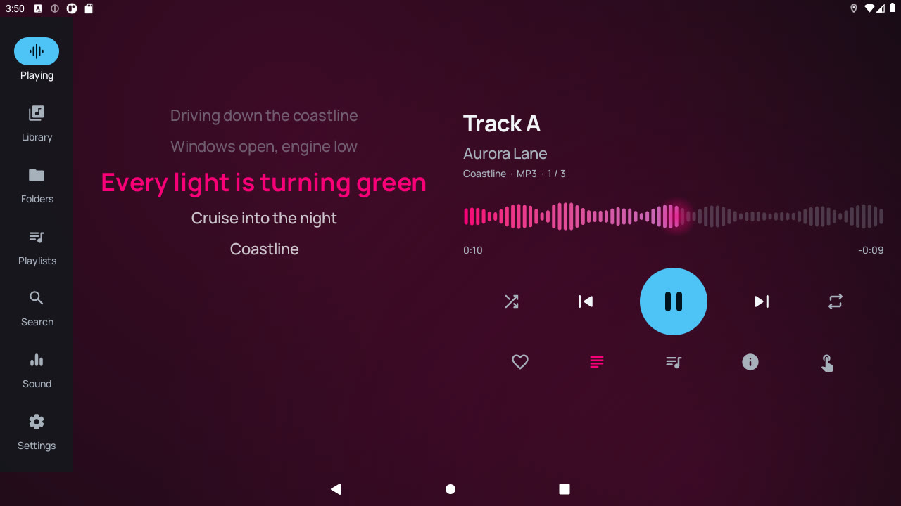

<div align="center">

# Cruise

**An offline music player built for the car, not for the phone.**

Folder-first library from your USB stick · a sound engine tuned for car cabins · seven skins that change the whole look ·
big, glanceable controls · steering-wheel and ignition aware.


[**Download the latest APK**](../../releases/latest) · [Features](#features) · [Skins](#seven-skins) · [Install](#install) · [Build](#build-from-source)


</div>

---

## Why Cruise

The stock players on Android head units are phone apps squeezed onto a dashboard: small targets, a flat song list,
no idea that the power is cut every time the engine stops. Cruise starts from the car:

- **Your music is a folder tree on a USB stick** — browse it as folders *or* as a proper library, both always in sync.
- **The driver only glances** — large type and touch targets, the most-used controls in the thumb zone, blind mode.
- **The power goes away** — it pauses when the ignition goes off, resumes on the same second when the car starts,
  and survives a full shutdown.
- **The sound should be as good as software can make it** — a clip-free DSP chain inside the player, with presets
  for real car cabins.
- **No internet** — nothing is streamed, nothing is uploaded, no account.

Developed and tested on a Renault Mégane III with an aftermarket "TS7" Android head unit (UNISOC SC7731E, Android 8.1,
1 GB RAM, 1280×720), but the UI is responsive for every screen from phones to ultra-wide bar displays.

## Features

### Playback
- Media3 / ExoPlayer with the FFmpeg extension: **MP3, FLAC (up to 24-bit/192 kHz), ALAC, AAC/M4A, Ogg Vorbis, Opus,
  WAV, MKA/WebM, AMR, MP2** — gapless.
- Background playback with a media session: notification, lock screen, steering-wheel and Bluetooth media keys.
- Queue and position saved continuously; resumes after a power cut, a reboot or a long sleep.
- Pause shortly after the ignition goes off (adjustable), resume when it comes back on.
- Smooth fades on play, pause and skip.

### Library
- Fast incremental scanner (only changed files are re-read) with pure-Kotlin tag readers for ID3v1/v2.2–2.4, FLAC and
  Vorbis comments, Ogg/Opus, MP4/ALAC atoms and WAV INFO.
- Albums, artists, genres, years, tracks, **quality** (Hi-Res / Lossless / Lossy), recently added, most played,
  favourites — each with its own sorting, plus an A–Z scrubber.
- Understands real-world sticks: `Artist/1973 - Album` folders, `CD1/CD2` discs, compilations, untagged files,
  `cover.jpg`/`folder.png`, CUE sheets as separate tracks, M3U/M3U8/PLS playlists (even ones written on a PC with
  `E:\Music\…` paths).
- **Accent-insensitive search** — "ete" finds "Été", "cafe" finds "Café".
- Playlists: create, reorder, save the queue as a playlist, export to `.m3u8` on the stick.

### Sound engine
- 10-band graphic EQ with a live spectrum and response curve, presets including **Mégane cabin** and **Highway**.
- **Automatic headroom** — boosts never clip; a look-ahead limiter catches the rest.
- Volume-dependent loudness compensation, bass shelf, stereo width, balance.
- **Driver focus** — time-aligns and balances the door speakers toward the driver (or the passenger).
- ReplayGain (track / album / automatic), TPDF dither, hold-to-compare A/B.
- Effects off = bit-exact passthrough (verified by unit tests).

### In the car
- Synced lyrics from `.lrc` files or embedded tags, track info sheet, queue panel.
- **Blind mode** — the whole screen becomes one gesture pad: tap to play/pause, swipe for tracks, swipe up/down for volume.
- Night skin that switches with the headlights (on head units that broadcast it).
- Steering-wheel mapping for "TW" head units, including remapping the phone and mixer buttons, and a call button
  that answers and hangs up.
- Backup and restore of every setting, playlist, favourite and play count to the USB stick.
- English and French.

## Seven skins

A skin changes everything: colours, typefaces, shapes, the animated backdrop, how the cover is presented, the animated
music bar and the navigation. Every skin passes WCAG AAA contrast for primary text.

| | | |
|:---:|:---:|:---:|
| <br>**Midnight** — colours follow each album cover | <br>**Neon Drive** — synthwave grid, neon frame, oscilloscope bar | <br>**Amber Cockpit** — tachometer cover, LED meter |
| <br>**Vinyl Lounge** — spinning record, swinging tonearm | <br>**Aurora** — moving northern lights | <br>**OLED Pure** — true black, big type, lightest on the CPU |
| <br>**Daylight** — high contrast for sunny days | <br>Live previews in Settings | <br>Blind mode |

## Screenshots

| Library | Synced lyrics | Sound |
|:---:|:---:|:---:|
|  |  |  |
| **Search** | **Queue** | **Phone, portrait** |
|  |  |  |

## Install

1. Download from [Releases](../../releases/latest):
   - `cruise-<version>-armeabi-v7a.apk` — most head units (32-bit, e.g. UNISOC SC7731E, Allwinner, older MediaTek).
   - `cruise-<version>-arm64-v8a.apk` — 64-bit units and phones.
   - `cruise-<version>-universal.apk` — if you are not sure (larger).
2. Copy it to a USB stick, open it with the unit's file manager and allow installing from unknown sources.
3. Open Cruise and allow access to your files (Android 11+: *All files access*). The library fills itself in the background.

Requires Android 6.0 or newer. Works without Google Play services.

## Build from source

Requirements: JDK 17+ (the JetBrains Runtime bundled with Android Studio works), Android SDK with platform 37.

```bash
git clone https://github.com/boulbeba115/Cruise-Car-Music-Player-for-Android.git
cd Cruise-Car-Music-Player-for-Android
./gradlew assembleDebug                 # debug APKs per ABI in app/build/outputs/apk/debug
./gradlew assembleRelease               # R8-shrunk release APKs
./gradlew testDebugUnitTest lintDebug   # unit + screenshot tests, lint
```

Screenshots of every screen size and skin are rendered on the JVM with Robolectric + Roborazzi:
`./gradlew :app:testDebugUnitTest -Proborazzi.test.record=true` → `app/build/outputs/roborazzi/`.

An emulator profile that mimics a 1280×720 head unit, the test-library generator and other tools are described in
[docs/toolchain.md](docs/toolchain.md).

## Architecture

Kotlin · Jetpack Compose · Hilt · Room (FTS4) · Media3 · coroutines/Flow — multi-module, with convention plugins in
`build-logic/`.

```
app/                 shell, navigation, theming, car events
core/model           media ids, folder scanning, natural sort
core/data            tag readers, CUE/LRC/M3U, Room database, scanner, artwork cache
core/audio           DSP chain (AudioProcessor), sound settings, spectrum tap
core/playback        MediaSessionService, queue persistence, sleep/wake, player connection
core/car             head-unit bridge, steering-wheel mapping, calls
core/designsystem    skins, typography, components, animated backdrops
core/ui              shared list items, covers, sheets
feature/*            nowplaying, library, folders, sound, settings
```

The full product specification, design decisions and roadmap are in [SPEC.md](SPEC.md); measured facts about the
reference head unit are in [docs/unit-findings.md](docs/unit-findings.md).

## Roadmap

- Voice search and commands while driving
- Steering-wheel buttons fully owned by Cruise on TW head units; set as the default music app
- APE, WavPack, DSF and WMA through a custom FFmpeg build
- Crossfade, parametric EQ, floating mini controller

## Privacy

Cruise has no network code and does not request the internet permission. Everything — library, statistics,
settings — stays on the device and, if you choose to back it up, on your own USB stick. Location is used only by the
optional *Settings → Car test* recorder (it logs vehicle speed to the USB stick for diagnosing a head unit) and only
while that test runs.
