<div align="center">


# Cruise

**An offline music player built for the car, not for the phone.**

Folder-first library from your USB stick · sound profiles tuned for car cabins · eight skins that change the whole look ·
whole-screen gestures · ignition aware.


[**Download the latest APK**](../../releases/latest) · [Features](#features) · [Skins](#eight-skins) · [Install](#install) · [Build](#build-from-source)

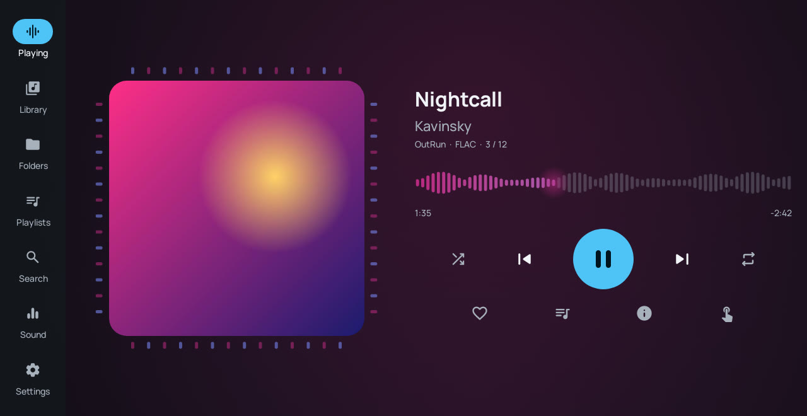

</div>

---

## Why Cruise

The stock players on Android head units are phone apps squeezed onto a dashboard: small targets, a flat song list,
no idea that the power is cut every time the engine stops. Cruise starts from the car:

- **Your music is a folder tree on a USB stick** — browse it as folders *or* as a proper library, both always in sync.
- **The driver only glances** — large type and touch targets, the most-used controls in the thumb zone, blind mode.
- **The power goes away** — it pauses when the ignition goes off, resumes on the same second when the car starts,
  and survives a full shutdown.
- **The sound should be as good as software can make it** — a clip-free DSP chain inside the player, with presets
  for real car cabins.
- **No internet** — nothing is streamed, nothing is uploaded, no account.

Developed and tested on a Renault Mégane III with an aftermarket "TS7" Android head unit (UNISOC SC7731E, Android 8.1,
1 GB RAM, 1280×720), but the UI is responsive for every screen from phones to ultra-wide bar displays.

## Features

### Playback
- Media3 / ExoPlayer with the FFmpeg extension: **MP3, FLAC (up to 24-bit/192 kHz), ALAC, AAC/M4A, Ogg Vorbis, Opus,
  WAV, MKA/WebM, AMR, MP2** — gapless.
- Background playback with a media session: notification, lock screen, steering-wheel and Bluetooth media keys.
- Queue and position saved continuously; resumes after a power cut, a reboot or a long sleep.
- Pause shortly after the ignition goes off (adjustable), resume when it comes back on.
- Smooth fades on play, pause and skip.

### Library
- One **Library** with tabs — **Folders · Albums · Artists · Genres · Playlists** — and search in its header.
- **Folders shows only folders that contain music**, straight from the library: no `Android`, `DCIM` or `Download`, and
  single-path chains such as `USB › Music › Rock` open directly on the first real choice.
- Fast incremental scanner (only changed files are re-read) with pure-Kotlin tag readers for ID3v1/v2.2–2.4, FLAC and
  Vorbis comments, Ogg/Opus, MP4/ALAC atoms and WAV INFO.
- Understands real-world sticks: `Artist/1973 - Album` folders, `CD1/CD2` discs, compilations, untagged files,
  `cover.jpg`/`folder.png`, CUE sheets as separate tracks, M3U/M3U8/PLS playlists (even ones written on a PC with
  `E:\Music\…` paths).
- **Accent-insensitive search** across folders, albums, artists and tracks — "ete" finds "Été", "cafe" finds "Café".
- Playlists: create, reorder, save the queue as a playlist, export to `.m3u8` on the stick; **Favourites, Most played
  and Recently added** fill themselves.
- Songs without art get an **illustrated cover from the active skin's own set** (158 in all, generated offline), a
  different one per song.

### Sound engine
- **Profile cards** — Natural, Mégane tuned, Bass boost, Vocal clarity, Highway, Night, Rock, Pop, Electronic, Jazz,
  Classical, Custom — one tap each, then just **Bass**, **Treble** and **Best sound for: Everyone / Driver**.
- Custom opens a 10-band graphic EQ with a live spectrum and response curve.
- **Automatic headroom** — boosts never clip; a look-ahead limiter catches the rest.
- Volume-dependent loudness compensation, ReplayGain (automatic), TPDF dither, hold-to-compare A/B.
- **Driver focus** — time-aligns and balances the door speakers toward the driver.
- Natural = bit-exact passthrough (verified by unit tests).

### In the car
- **A song is always ready**: Now Playing opens on the last song where you left it; on a fresh install Cruise asks for
  access to your music and picks a random song as soon as the stick is read.
- **Whole-screen gestures on Now Playing** — no overlay, taps untouched: *hold* anywhere to play/pause (a ring fills
  under your finger), *hold and slide* to scrub, *swipe* left/right for tracks, up/down for volume.
- Steering-wheel and Bluetooth media keys through the media session.
- Synced lyrics from `.lrc` files or embedded tags, track info sheet, queue panel.
- **Blind mode** — the whole screen becomes one gesture pad.
- Night skin that switches with the headlights (on head units that broadcast it).
- Answers Android's music-player requests and audio files opened from a file manager.
- Backup and restore of every setting, playlist, favourite and play count to the USB stick.
- English and French.

## Eight skins

A skin changes everything: colours, typefaces, shapes, the animated backdrop, how the cover is presented, the animated
music bar and the navigation. Covers are drawn as objects that live with the music. Every skin passes WCAG AAA
contrast for primary text.

| | | |
|:---:|:---:|:---:|
| <br>**Midnight** — record sleeve, the disc slides out and spins | 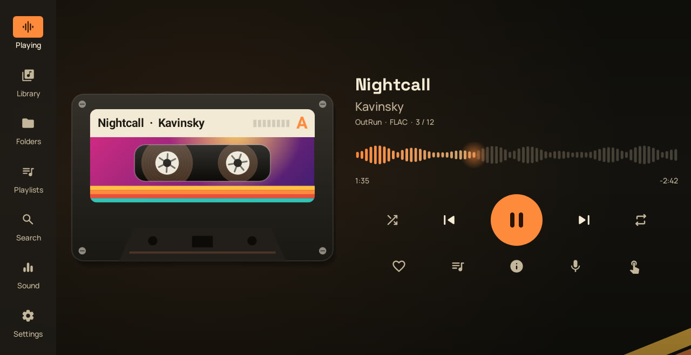<br>**Tape Deck** — chrome cassette, deck transport with a tape counter | 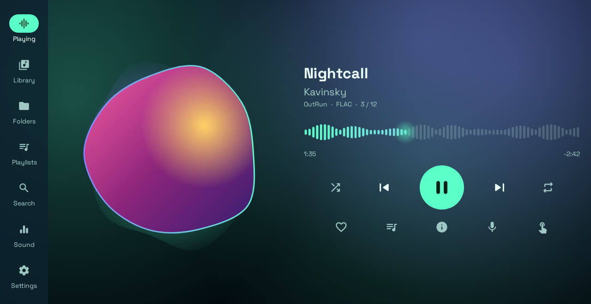<br>**Aurora** — a liquid cover that moves with the music |
| 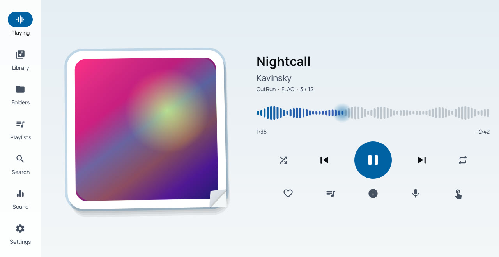<br>**Daylight** — die-cut sticker with a peel corner | 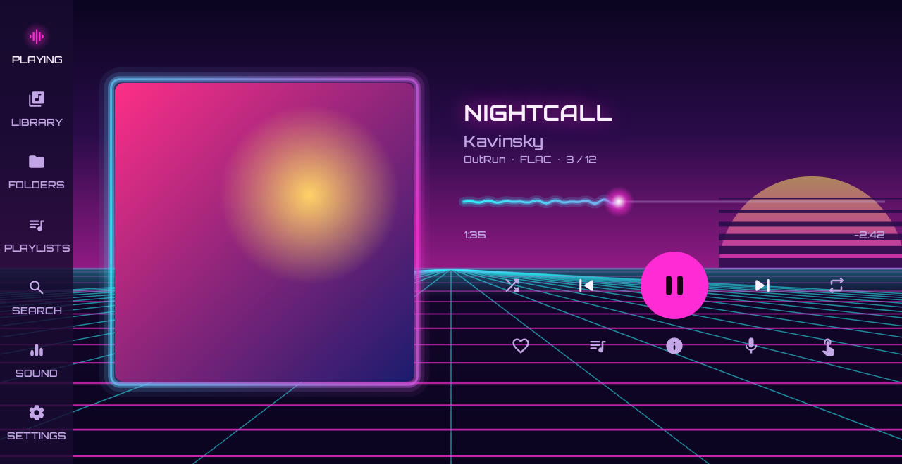<br>**Neon City** — LED billboard on a rooftop, your song on a banner towed by a neon plane | 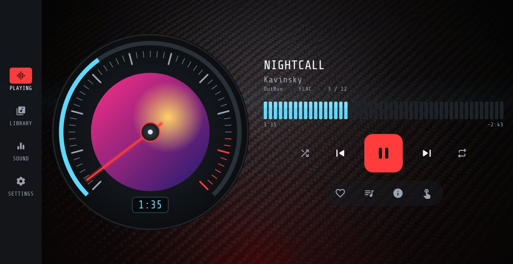<br>**Sport Cockpit** — rev counter cover, LED meter |
| 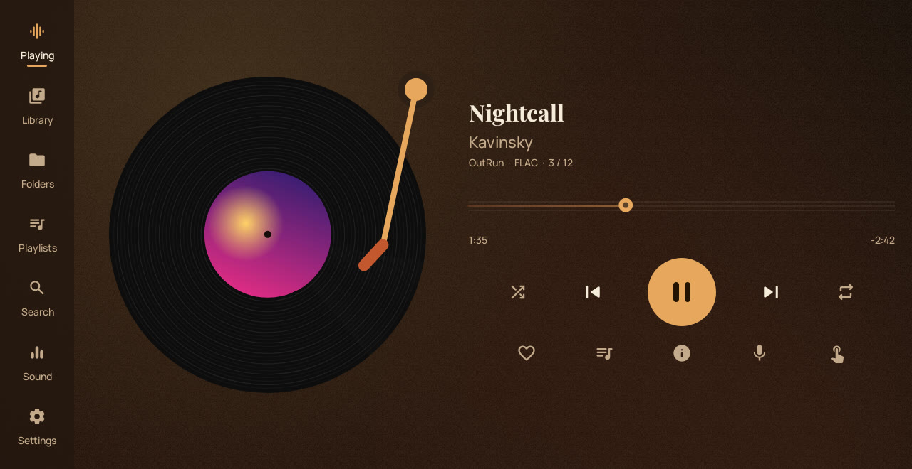<br>**Vinyl Lounge** — picture disc, tonearm that follows the song | 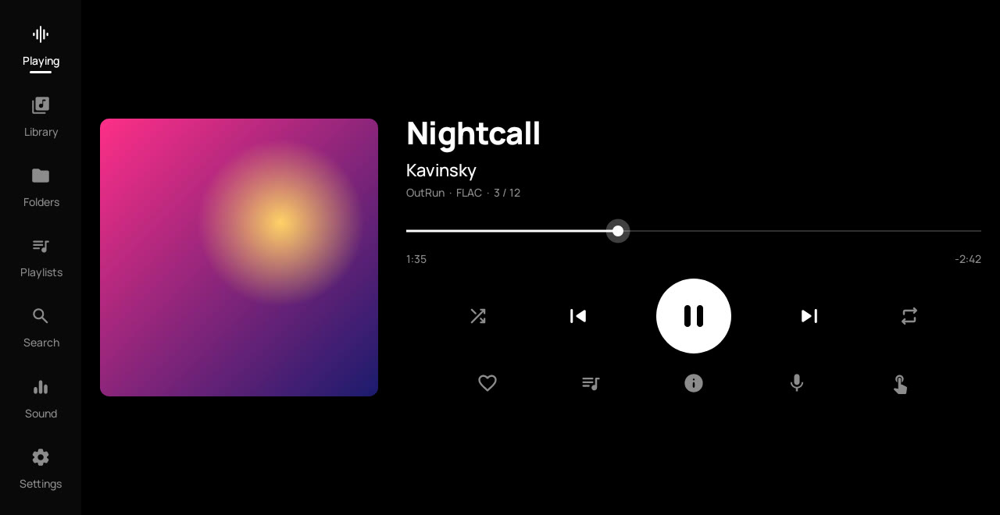<br>**OLED Pure** — true black, lightest on the CPU | 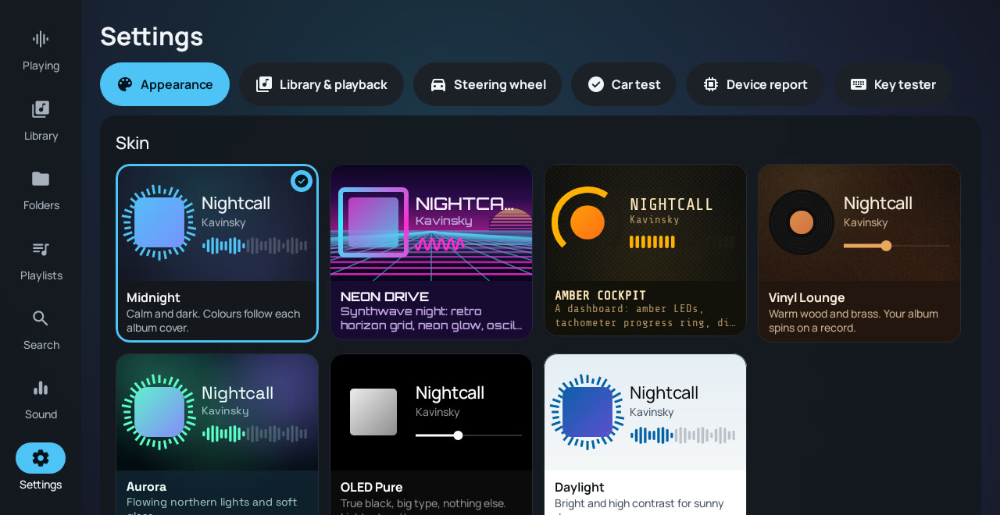<br>Live previews in Settings |

## Screenshots

| Library: folders with music only | Library: albums | Sound profiles |
|:---:|:---:|:---:|
| 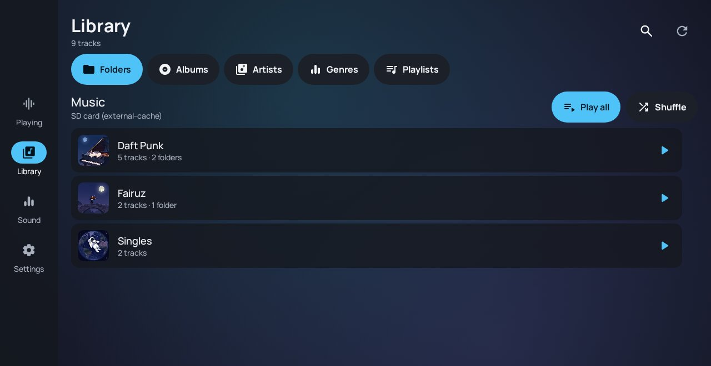 | 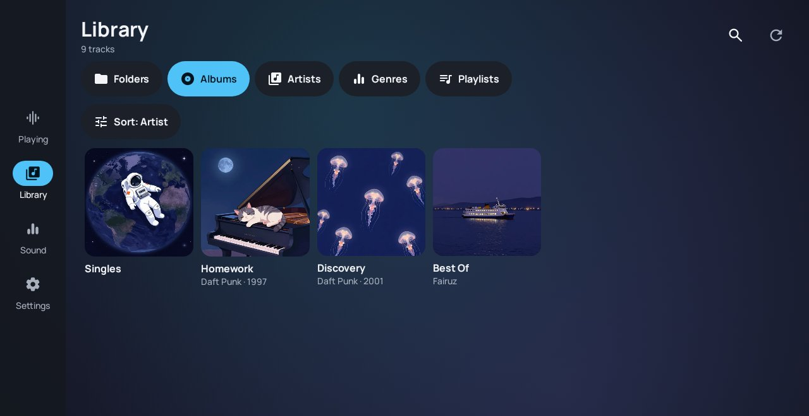 | 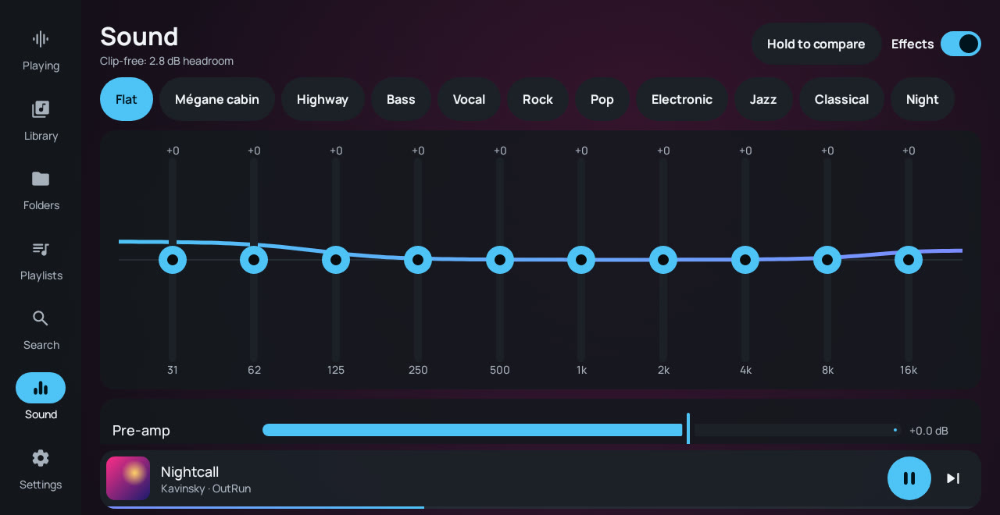 |
| **Search inside the Library** | **Fast scroller with a letter bubble** | **Queue** |
| 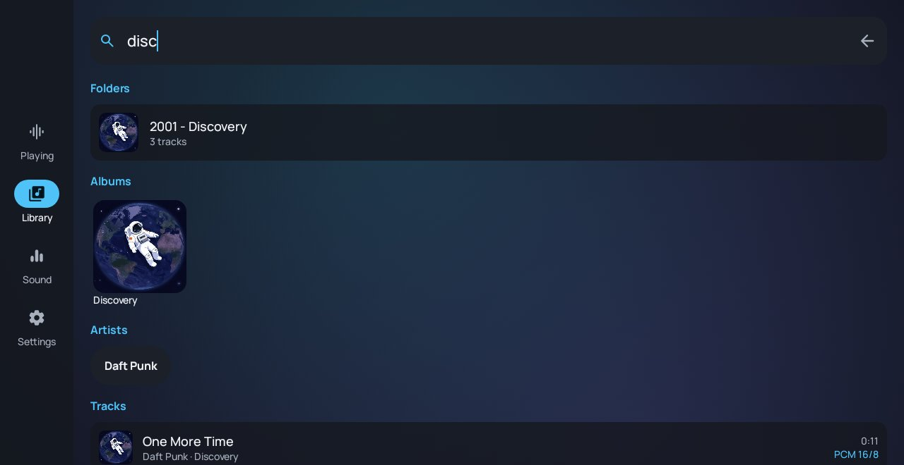 | 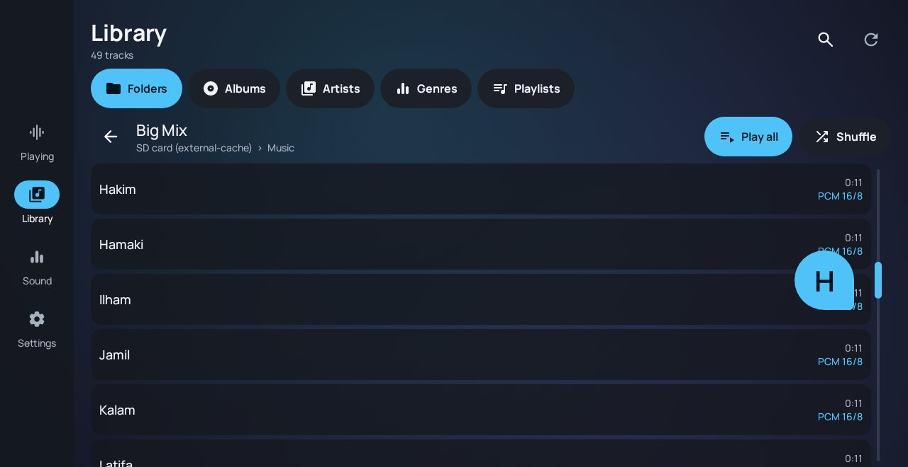 | 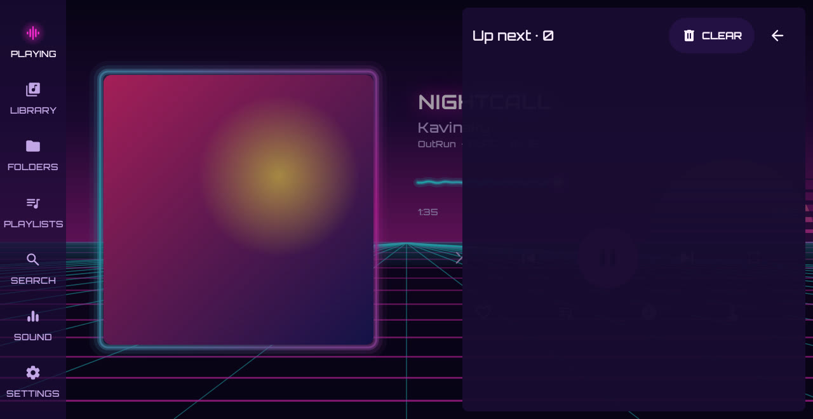 |
| **Blind mode: whole-screen gestures** | **Long names scroll along the banner** | **Phone, portrait** |
| 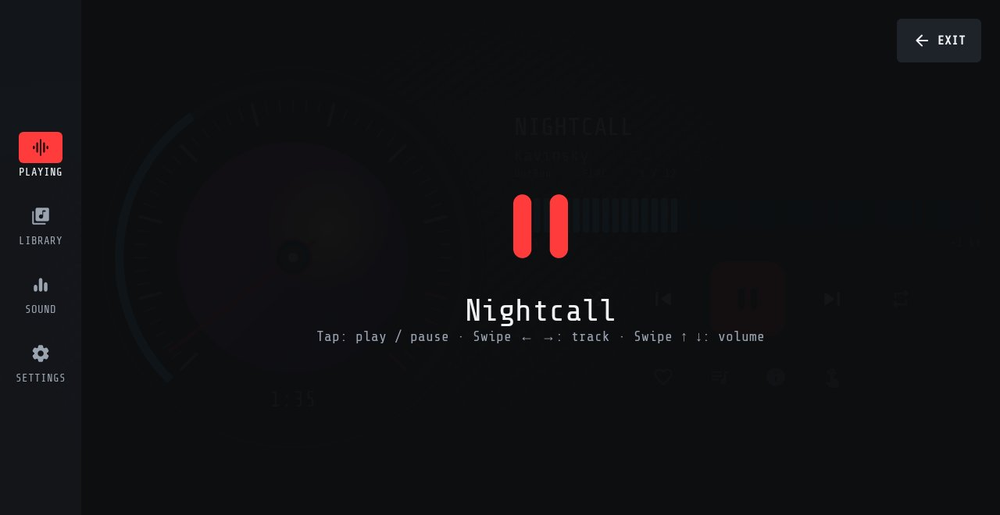 | 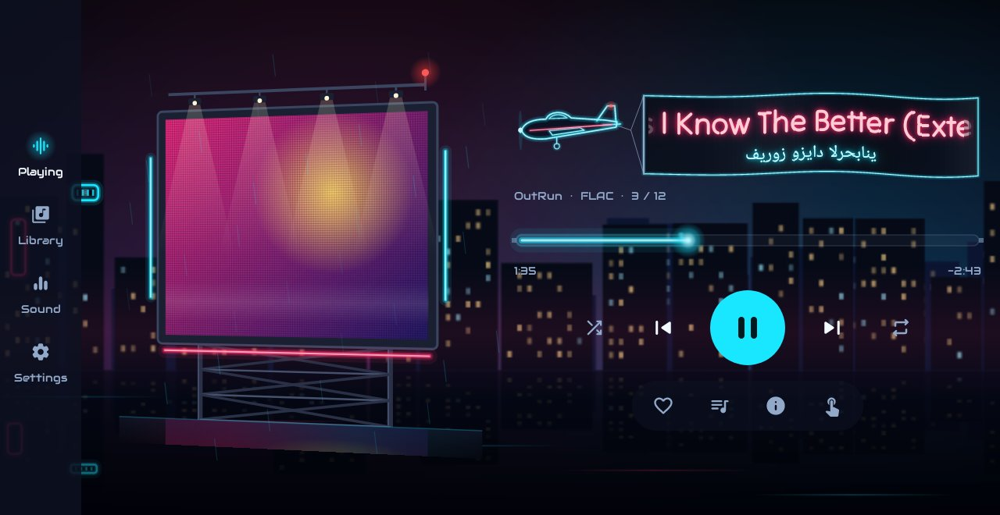 | 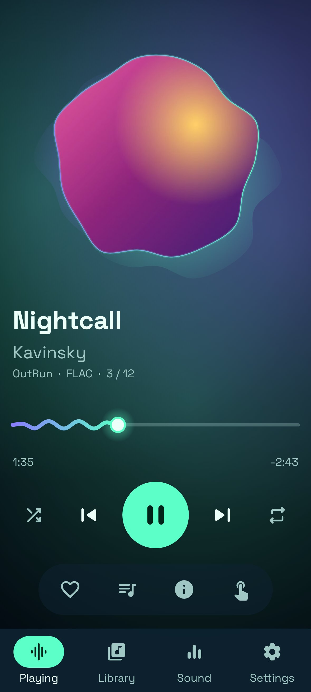 |

### Songs without a cover

Each skin brings its own set of about twenty illustrated covers in its style, generated offline. Every song without art
gets one of them, a different one per song, and it stays the same for that song.

| Neon City | Vinyl Lounge | Tape Deck |
|:---:|:---:|:---:|
| 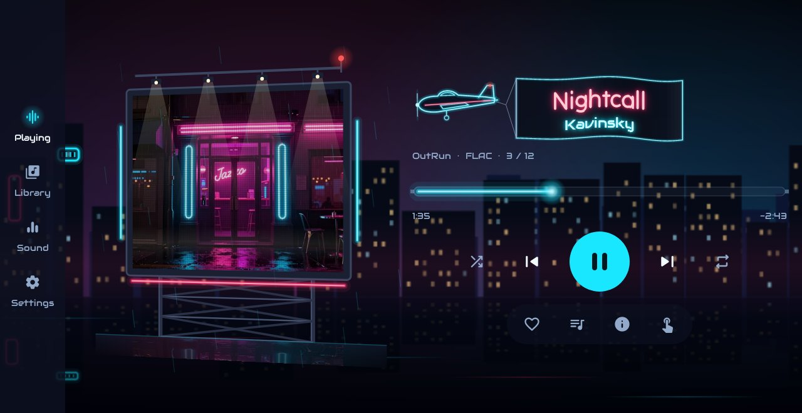 | 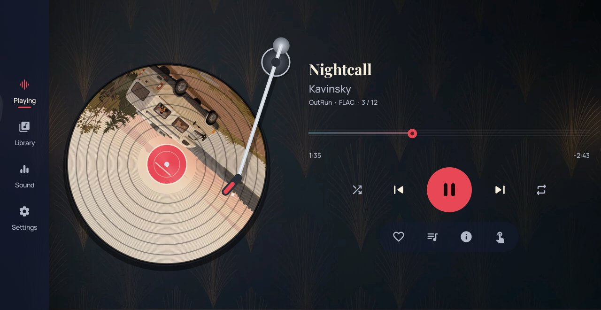 | 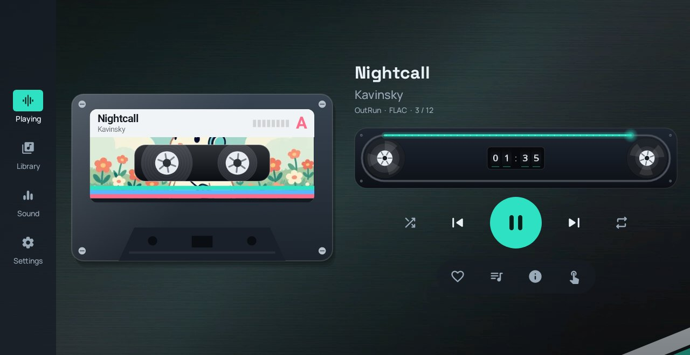 |

## Install

1. Download from [Releases](../../releases/latest):
   - `cruise-<version>-armeabi-v7a.apk` — most head units (32-bit, e.g. UNISOC SC7731E, Allwinner, older MediaTek).
   - `cruise-<version>-arm64-v8a.apk` — 64-bit units and phones.
   - `cruise-<version>-universal.apk` — if you are not sure (larger).
2. Copy it to a USB stick, open it with the unit's file manager and allow installing from unknown sources.
3. Open Cruise and allow access to your music when it asks (Android 11+: *All files access*). The library fills itself
   in the background and a song is ready on Now Playing as soon as the stick is read.

Requires Android 6.0 or newer. Works without Google Play services.

## Build from source

Requirements: JDK 17+ (the JetBrains Runtime bundled with Android Studio works), Android SDK with platform 37.

```bash
git clone https://github.com/boulbeba115/Cruise-Car-Music-Player-for-Android.git
cd Cruise-Car-Music-Player-for-Android
./gradlew assembleDebug                 # debug APKs per ABI in app/build/outputs/apk/debug
./gradlew assembleRelease               # R8-shrunk release APKs
./gradlew testDebugUnitTest lintDebug   # unit + screenshot tests, lint
```

Screenshots of every screen size and skin are rendered on the JVM with Robolectric + Roborazzi:
`./gradlew :app:testDebugUnitTest -Proborazzi.test.record=true` → `app/build/outputs/roborazzi/`.

An emulator profile that mimics a 1280×720 head unit, the test-library generator and other tools are described in
[docs/toolchain.md](docs/toolchain.md).

## Architecture

Kotlin · Jetpack Compose · Hilt · Room (FTS4) · Media3 · coroutines/Flow — multi-module, with convention plugins in
`build-logic/`.

```
app/                 shell, navigation, theming, car events
core/model           media ids, folder scanning, natural sort
core/data            tag readers, CUE/LRC/M3U, Room database, scanner, artwork cache
core/audio           DSP chain (AudioProcessor), sound settings, spectrum tap
core/playback        MediaSessionService, queue persistence, sleep/wake, player connection
core/car             TW head-unit bridge, steering-wheel mapping, calls (for the steering-wheel app)
core/designsystem    skins, typography, components, animated backdrops
core/ui              shared list items, covers, sheets
feature/*            nowplaying, library (folders, albums, playlists, search), sound, settings
feature/carlab       car test, device report, key tester, steering screen (not in the Cruise APK)
```

The full product specification, design decisions and roadmap are in [SPEC.md](SPEC.md); measured facts about the
reference head unit are in [docs/unit-findings.md](docs/unit-findings.md).

## Roadmap

- **Cruise Wheel**: a separate app that takes over the steering-wheel buttons (short, long, double press, combinations)
  and reports which car features the head unit exposes — see [CHANGE_REQUESTS.md](CHANGE_REQUESTS.md) CR-10
- APE, WavPack, DSF and WMA through a custom FFmpeg build
- Crossfade, parametric EQ, floating mini controller

## Privacy

Cruise has no network code and does not request the internet permission, the microphone or your location. Everything
— library, statistics, settings — stays on the device and, if you choose to back it up, on your own USB stick.
